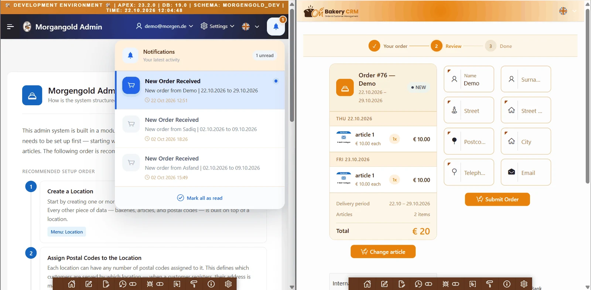
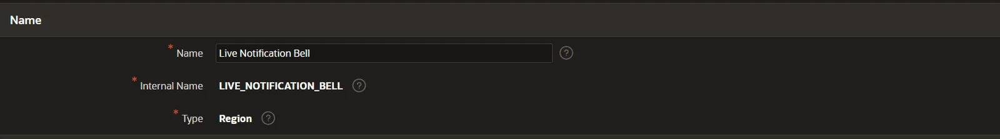
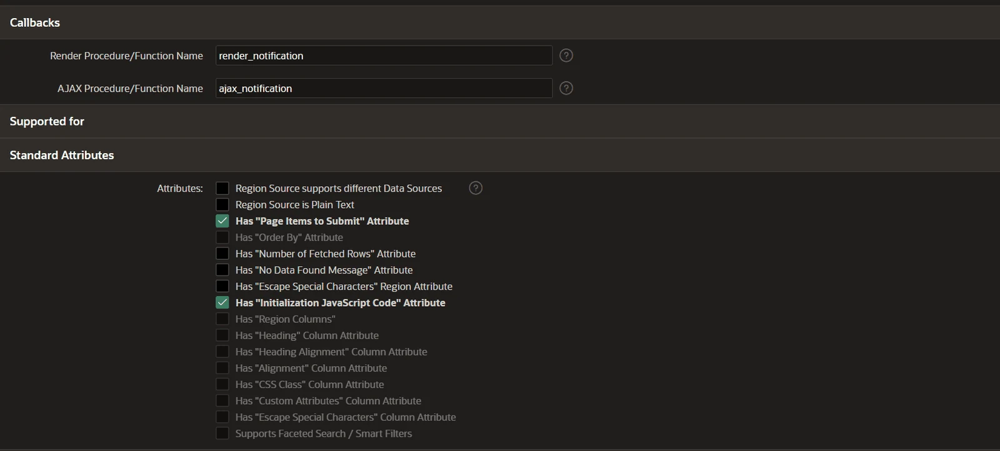
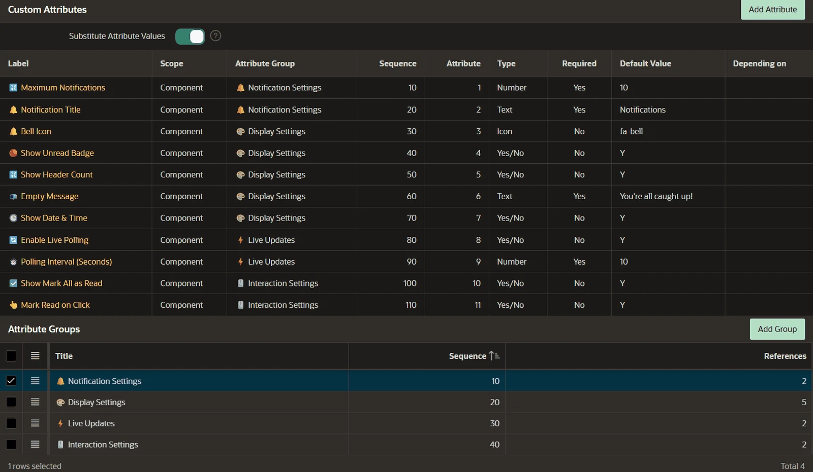
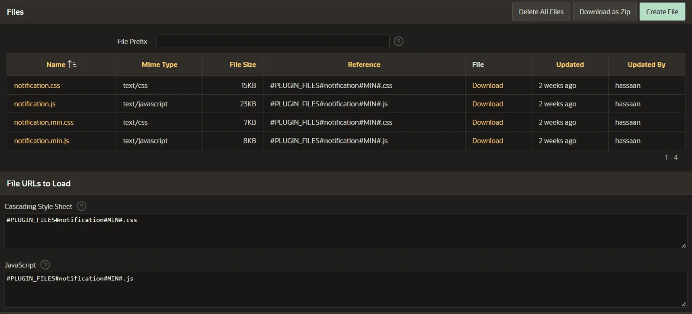
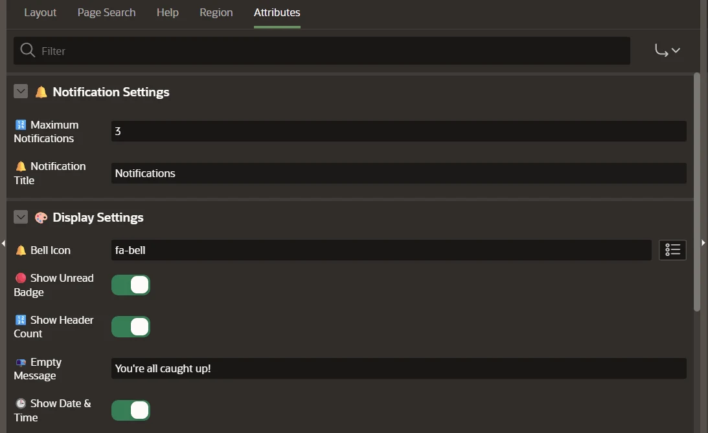
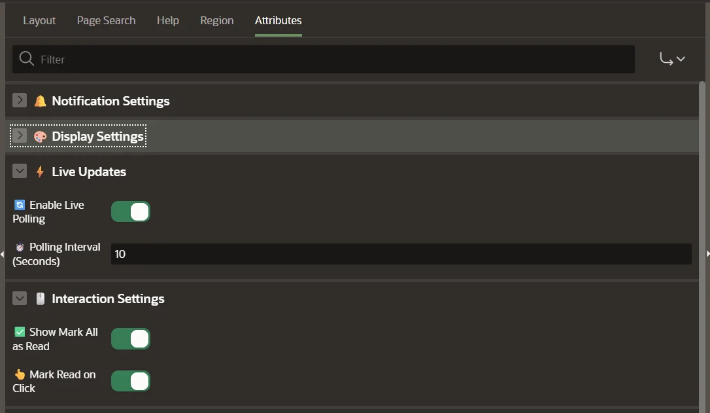
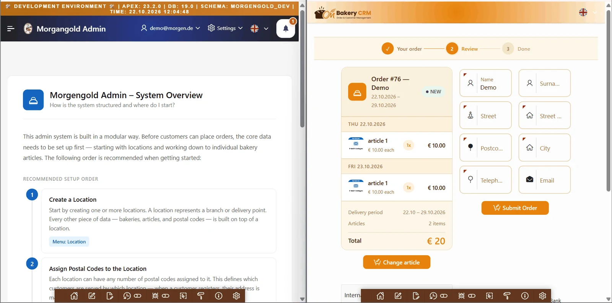
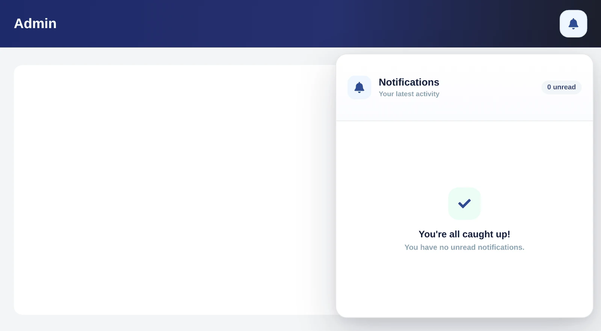

# Build a Live Notification Bell Plugin in Oracle APEX — Real-Time Order Alerts Without a Page Refresh

[](LICENSE)


> A reusable Oracle APEX region plugin that puts a live notification bell in the navigation bar: new orders appear within seconds, with an unread badge and no page refresh.

<p align="center">
  
</p>

**By Hassaan Ahmed Tahir — Senior Oracle APEX Developer · [Read the full tutorial](https://apexwithhassaan.vercel.app/blog/live-notification-bell-plugin)**

---

## 📁 Repository structure

```
apex-live-notification-bell-plugin/
src/database/01_sequence_and_table.sql    # MG_NOTI_SEQ and MG_NOTIFICATIONS
src/database/02_trigger.sql               # TRG_ORDER_NOTIFICATION — creates notifications on order events
src/database/03_notifications_pkg.sql     # MGOR_NOTIFICATIONS_PKG spec and body
src/plugin/notification.sql               # plugin PL/SQL source (helpers, render and AJAX callbacks)
src/plugin/notification.css               # plugin file: bell, badge and panel styles
src/plugin/notification.js                # plugin file: polling, panel and actions
docs/images/                              # screenshots from the blog post
CHANGELOG.md
LICENSE                                   # MIT
README.md
```

> 💡 Every file above contains the exact code from the tutorial below, ready to copy or run.

---

The **Morgangold** bakery system runs on two Oracle APEX applications. Customers place their orders in the **ordering app**, and the bakery team works in a separate **admin app**. The question I kept hearing from the team was simple: *"How do we know a new order just came in?"*

Refreshing a report every few minutes is not a real answer. What the team wanted was what every modern web app has: a **bell in the navigation bar** that shows a red badge the moment an order arrives, and a tidy dropdown with the latest notifications — without anyone touching the refresh button.

So I built it as a **Region Plugin** called **Live Notification Bell**. A database trigger writes a notification row for every new order, and the plugin sits on the **Global Page** and checks for news every few seconds with a tiny AJAX call. When something new arrives, the bell rings, the badge updates and the panel slides in on its own. One region, eleven settings, and every page of the admin app has live notifications.

> ✅ **What you'll have at the end:** a reusable plug-in that places a notification bell in the navigation bar, polls the database every few seconds, rings the bell and slides the panel open when a new order arrives, shows unread notifications in blue and read ones dimmed, marks them read with one click (or all at once), and shows a friendly *"You're all caught up!"* message when nothing is left — all without a page refresh.

> 🧪 **Tested on:** Oracle APEX 23.2 with Oracle Database 19. The plugin uses only standard APIs (`apex_plugin`, `apex_json`, `apex_escape`, `apex.server.plugin`); screen labels can differ slightly between versions.

## 📑 Table of Contents

1. [What the Plugin Does](#what-it-does)
2. [How It Works](#how-it-works)
3. [Step 1: Create the Database Objects](#step-1)
4. [Step 2: Create the Plug-in](#step-2)
5. [Step 3: Add the PL/SQL Code](#step-3)
6. [Step 4: Callbacks and Standard Attributes](#step-4)
7. [Step 5: Attribute Groups and Custom Attributes](#step-5)
8. [Step 6: The CSS File](#step-6)
9. [Step 7: The JavaScript File](#step-7)
10. [Step 8: Upload the Files and Set File URLs to Load](#step-8)
11. [Step 9: Add the Bell to the Global Page](#step-9)
12. [Step 10: Test It with a Real Order](#step-10)
13. [Under the Hood: The Live Update Cycle](#live-cycle)
14. [Gotchas and Tips](#gotchas)
15. [One Plugin, Every App](#ideas)
16. [Production Checklist](#checklist)
17. [Wrap-Up](#wrap-up)

<a id="what-it-does"></a>

## 1. What the Plugin Does

For the bakery team it's a bell that simply tells them when there is something new. For the developer it's one region on the Global Page with eleven settings.

|  | Without the plugin | Live Notification Bell |
|---|---|---|
| How the team learns about orders | Open the orders report and refresh it | A red **badge** on the bell within seconds — the default check runs every 10 seconds |
| Getting attention | — | The bell **rings** and the panel **slides in** for 5 seconds, then closes by itself |
| Unread vs read | — | Unread rows in **blue** with an accent bar, read rows calm and dimmed |
| Marking as read | — | Click one notification, or **Mark all as read** — instantly, without a refresh |
| Who sees what | Everyone sees the same report | Each user only sees notifications for **their own company** |
| Reuse | Built again per page | One region on **Page 0** — every page of the app gets it |

<a id="how-it-works"></a>

## 2. How It Works

The work is split between the database, which *creates* notifications, and the plugin, which *shows* them. JavaScript keeps the two in sync.

1. 🛒 **New order** — A customer submits an order in the ordering app
2. ⚡ **Trigger** — The orders trigger writes a notification row
3. 🔄 **CHECK_NEW** — Every 10 s the browser asks: anything newer than my last ID?
4. 🧩 **REFRESH** — The server returns fresh bell + panel HTML
5. 🔔 **Bell rings** — Badge updates, panel slides in for 5 s

| Part | Runs | Job |
|---|---|---|
| `MG_NOTIFICATIONS` | Always | Stores every notification with its company, read flag and timestamp |
| `TRG_ORDER_NOTIFICATION` | After every insert into `ORDERS` | Finds the customer and the company responsible for their postcode, builds the message and inserts the notification |
| `MGOR_NOTIFICATIONS_PKG` | When called | Counts unread notifications per company and marks a single notification as read |
| `render_notification` | When the page renders | Reads the eleven settings and writes the root element; `print_content` draws the bell, badge and panel |
| `ajax_notification` | On every AJAX call | Answers `CHECK_NEW`, `REFRESH`, `MARK_READ` and `MARK_ALL_READ` |
| `notification.js` | On page load | Polls, swaps the HTML, opens and closes the panel, marks notifications read, auto-opens the panel for new ones |
| `notification.css` | Always | Bell, badge, panel, unread / read styles, empty state, swipe and ring animations, mobile layout |

<a id="step-1"></a>

## 3. Step 1: Create the Database Objects

The plugin reads from one table and one package. Create them first — a sequence for the IDs, the notification table, the trigger on the orders table, and a small helper package.

### The sequence and the table

Every column has a clear job: `NOTI_COMP_FK` scopes the row to a company, `NOTI_READ_YN` starts as `NO`, and `NOTI_CREATED` fills itself with `SYSTIMESTAMP`. The `NOTI_ID` always grows, which matters later — the browser uses the highest ID it knows as a *watermark* to spot new rows.

```sql
CREATE SEQUENCE MG_NOTI_SEQ
    START WITH 1
    INCREMENT BY 1
    NOCACHE
    ORDER
    NOCYCLE;
```

```sql
CREATE TABLE "MG_NOTIFICATIONS"
   (	"NOTI_ID" NUMBER DEFAULT "MG_NOTI_SEQ"."NEXTVAL" NOT NULL ENABLE,
	"NOTI_TYPE" VARCHAR2(100),
	"NOTI_TITLE" VARCHAR2(500),
	"NOTI_MESSAGE" CLOB,
	"NOTI_ORDR_FK" NUMBER,
	"NOTI_CUST_FK" NUMBER,
	"NOTI_READ_YN" VARCHAR2(3) DEFAULT 'NO',
	"NOTI_COMP_FK" NUMBER,
	"NOTI_CREATED" TIMESTAMP (6) DEFAULT SYSTIMESTAMP,
	"NOTI_CREATED_BY" VARCHAR2(4000),
	 PRIMARY KEY ("NOTI_ID")
  USING INDEX  ENABLE
   ) ;
```

### The trigger

`TRG_ORDER_NOTIFICATION` fires **after every insert** into `ORDERS` — so it doesn't matter which app or process creates the order. In order, it:

- **Finds the customer** name and postcode, with *Unknown Customer* as a safe fallback.
- **Finds the right company** through the active location that serves the customer's postcode (`LOCATION_POSTCODE` → `LOCATION`).
- **Falls back** to the first active location's company if the postcode isn't assigned anywhere.
- **Builds the message**, e.g. *New order from Demo | 22.10.2026 to 29.10.2026*.
- **Inserts the notification** with type `NEW_ORDER` and title *New Order Received*.

```sql
create or replace TRIGGER TRG_ORDER_NOTIFICATION
AFTER INSERT ON ORDERS
FOR EACH ROW
DECLARE
    v_cust_name  VARCHAR2(4000) := 'Unknown Customer';
    v_comp_id    NUMBER;
    v_postcode   VARCHAR2(4000);
    v_message    VARCHAR2(4000);
BEGIN
    -- Step 1: Get customer name and postcode
    BEGIN
        SELECT
            c.CUST_NAME || ' ' || c.CUST_SURNAME,
            c.CUST_POSTCODE
        INTO v_cust_name, v_postcode
        FROM CUSTOMER c
        WHERE c.CUST_ID = :NEW.ORDR_CUST_FK;
    EXCEPTION WHEN NO_DATA_FOUND THEN
        v_cust_name := 'Unknown Customer';
        v_postcode  := NULL;
    END;

    -- Step 2: Get correct company from LOCATION via postcode
    BEGIN
        SELECT l.LOCA_COMP_FK
        INTO v_comp_id
        FROM LOCATION_POSTCODE lp
        JOIN LOCATION l ON l.LOCA_ID = lp.LOPO_LOCA_FK
        WHERE lp.LOPO_NAME   = v_postcode
          AND lp.LOPO_ACTIVE_YN  = 'YES'
          AND lp.LOPO_DELETED_YN = 'NO'
          AND l.LOCA_ACTIVE_YN   = 'YES'
          AND l.LOCA_DELETED_YN  = 'NO'
        FETCH FIRST 1 ROWS ONLY;
    EXCEPTION WHEN NO_DATA_FOUND THEN
        v_comp_id := NULL;
    END;

    -- Step 3: Fallback - get first active company
    IF v_comp_id IS NULL THEN
        BEGIN
            SELECT LOCA_COMP_FK
            INTO v_comp_id
            FROM LOCATION
            WHERE LOCA_ACTIVE_YN  = 'YES'
              AND LOCA_DELETED_YN = 'NO'
            FETCH FIRST 1 ROWS ONLY;
        EXCEPTION WHEN OTHERS THEN
            v_comp_id := NULL;
        END;
    END IF;

    -- Step 4: Build message
    v_message := 'New order from ' || v_cust_name ||
                 ' | ' || TO_CHAR(:NEW.ORDR_START_DATE, 'DD.MM.YYYY') ||
                 ' to '   || TO_CHAR(:NEW.ORDR_END_DATE, 'DD.MM.YYYY');

    -- Step 5: Insert notification
    INSERT INTO MG_NOTIFICATIONS (
        NOTI_ID,
        NOTI_TYPE,
        NOTI_TITLE,
        NOTI_MESSAGE,
        NOTI_ORDR_FK,
        NOTI_CUST_FK,
        NOTI_COMP_FK,
        NOTI_CREATED_BY
    ) VALUES (
        MG_NOTI_SEQ.NEXTVAL,
        'NEW_ORDER',
        'New Order Received',
        v_message,
        :NEW.ORDR_ID,
        :NEW.ORDR_CUST_FK,
        v_comp_id,
        'SYSTEM'
    );

EXCEPTION WHEN OTHERS THEN NULL;
END;
/
```

> ℹ️ **Why `EXCEPTION WHEN OTHERS THEN NULL`?** A notification is nice to have — the order itself is what matters. If anything goes wrong while building the notification, the customer's order is still saved. The trade-off is that a failed notification is silent, so see the [Gotchas](#gotchas) for a logging idea.

### The helper package

`MGOR_NOTIFICATIONS_PKG` keeps the shared logic in one place. The plugin uses `get_unread_count` for the badge and `mark_read` when a notification is clicked. `send_push_notification` sends an APEX PWA push message to every user of a company — it isn't used by the bell, but it's ready for the day the app runs as a Progressive Web App.

```sql
create or replace PACKAGE MGOR_NOTIFICATIONS_PKG AS

PROCEDURE send_push_notification(
    pi_comp_id  IN NUMBER
  , pi_title    IN VARCHAR2
  , pi_message  IN VARCHAR2
  , pi_ordr_id  IN NUMBER DEFAULT NULL

);

PROCEDURE mark_read(
    pi_noti_id IN NUMBER

);

FUNCTION get_unread_count(
    pi_comp_id IN NUMBER
) RETURN NUMBER;

END MGOR_NOTIFICATIONS_PKG;
/
```

```sql
create or replace PACKAGE BODY MGOR_NOTIFICATIONS_PKG AS

PROCEDURE send_push_notification(
    pi_comp_id  IN NUMBER
  , pi_title    IN VARCHAR2
  , pi_message  IN VARCHAR2
  , pi_ordr_id  IN NUMBER DEFAULT NULL

)
IS
    BEGIN
        FOR r IN (
            SELECT USER_EMAIL
            FROM USERS
            WHERE USER_COMP_FK = pi_comp_id
        ) LOOP
            BEGIN
                APEX_PWA.SEND_PUSH_NOTIFICATION(
                    p_application_id => 148,
                    p_user_name      => r.USER_EMAIL,
                    p_title          => pi_title,
                    p_body           => pi_message
                );
            EXCEPTION WHEN OTHERS THEN NULL;
            END;
        END LOOP;
    END send_push_notification;

PROCEDURE mark_read(
    pi_noti_id IN NUMBER
)
IS
    BEGIN
        UPDATE MG_NOTIFICATIONS
        SET    NOTI_READ_YN = 'YES'
        WHERE  NOTI_ID = pi_noti_id;
        COMMIT;
    END mark_read;

FUNCTION get_unread_count(
    pi_comp_id IN NUMBER
) RETURN NUMBER

IS
    v_count NUMBER := 0;
    BEGIN
        SELECT COUNT(*)
        INTO   v_count
        FROM   MG_NOTIFICATIONS
        WHERE  NOTI_COMP_FK = pi_comp_id
        AND    NOTI_READ_YN = 'NO';
        RETURN v_count;
    EXCEPTION WHEN OTHERS THEN
        RETURN 0;
    END get_unread_count;

END MGOR_NOTIFICATIONS_PKG;
/
```

> 💡 **Default from a sequence:** `NOTI_ID NUMBER DEFAULT MG_NOTI_SEQ.NEXTVAL` works on Oracle Database 12c and later, so any insert gets an ID even without the trigger. In your own schema, keep the sequence and the table in the same schema as the APEX parsing schema.

<a id="step-2"></a>

## 4. Step 2: Create the Plug-in

Go to **Shared Components → Plug-ins → Create**, choose **From Scratch** and fill in the identification:

| Setting | Value | Why |
|---|---|---|
| Name | `Live Notification Bell` | What developers see in the region Type list |
| Internal Name | `LIVE_NOTIFICATION_BELL` | Unique ID of the plug-in inside the application |
| Type | **Region** | The bell is placed on a page like any other region |

<p align="center">
  <br>
  <em>Figure 1 · Plug-in Name and Type. Name Live Notification Bell, internal name LIVE_NOTIFICATION_BELL, type Region.</em>
</p>

<a id="step-3"></a>

## 5. Step 3: Add the PL/SQL Code

All four parts go into **Source → PL/SQL Code** of the plug-in, one below the other, in the order shown here. Together they form one block: a small helper area, a procedure that draws the bell, the render callback and the AJAX callback.

### Part 1 — Configuration and helpers

The top of the code prepares everything the two callbacks share:

- **`t_config`** — one record that holds all eleven settings, so they are read in one place and passed around as one value.
- **`get_current_company_id`** — looks up the logged-in user in `USERS` by e-mail (`APP_USER`) and returns their company, or `-1` when the user isn't found — which simply shows an empty bell.
- **`get_config`** — reads `attribute_01` … `attribute_11` with safe defaults, keeps *Maximum Notifications* between 1 and 100, never lets polling run faster than every 5 seconds, and adds the `fa` prefix to the icon if it's missing.

```sql
--------------------------------------------------------------------------------
-- S&H Software Solutions
-- Live Notification Bell - Oracle APEX Region Plugin
-- -----------------------------------------------------------------------------
-- Component : PL/SQL Code (render + AJAX callbacks)
-- Version   : 1.0.0
-- Date      : 2026-10-22
-- Author    : S&H Software Solutions
-- License   : MIT License. This code is free and open to use, modify,
--             and redistribute, with or without attribution, for
--             personal or commercial projects.
-- -----------------------------------------------------------------------------
-- Built for Oracle APEX 23.2 with Oracle Database 19.
-- Render callback : render_notification
-- AJAX callback   : ajax_notification
-- Requires        : MG_NOTIFICATIONS table, MGOR_NOTIFICATIONS_PKG package
--
-- The bell + panel HTML is built by one procedure (print_content), used on
-- page render and by the AJAX action "REFRESH", so a live refresh always
-- returns exactly the same markup as the first page load.
--------------------------------------------------------------------------------


--------------------------------------------------------------------------------
-- CONFIG RECORD
--------------------------------------------------------------------------------
TYPE t_config IS RECORD (
      max_notifications     NUMBER
    , title                 VARCHAR2(4000)
    , icon_class            VARCHAR2(4000)
    , show_badge_yn         VARCHAR2(1)
    , show_header_count_yn  VARCHAR2(1)
    , empty_message         VARCHAR2(4000)
    , show_datetime_yn      VARCHAR2(1)
    , polling_yn            VARCHAR2(1)
    , poll_interval         NUMBER
    , show_mark_all_yn      VARCHAR2(1)
    , mark_read_click_yn    VARCHAR2(1)
);


--------------------------------------------------------------------------------
-- GET CURRENT USER COMPANY
--------------------------------------------------------------------------------
FUNCTION get_current_company_id
RETURN NUMBER
IS
    l_comp_id USERS.USER_COMP_FK%TYPE;
BEGIN

    SELECT USER_COMP_FK
      INTO l_comp_id
      FROM USERS
     WHERE LOWER(USER_EMAIL) = LOWER(V('APP_USER'))
       AND ROWNUM = 1;

    RETURN l_comp_id;

EXCEPTION
    WHEN NO_DATA_FOUND THEN
        RETURN -1;

END get_current_company_id;


--------------------------------------------------------------------------------
-- READ PLUGIN ATTRIBUTES
--
-- 01 = Maximum Notifications
-- 02 = Notification Title
-- 03 = Bell Icon
-- 04 = Show Unread Badge
-- 05 = Show Header Count
-- 06 = Empty Message
-- 07 = Show Date & Time
-- 08 = Enable Live Polling
-- 09 = Polling Interval (Seconds)
-- 10 = Show Mark All as Read
-- 11 = Mark Read on Click
--------------------------------------------------------------------------------
FUNCTION get_config (
    p_region IN apex_plugin.t_region
)
RETURN t_config
IS
    l_cfg   t_config;
    l_icon  VARCHAR2(4000);
BEGIN

    l_cfg.max_notifications :=
        NVL(
            TO_NUMBER(p_region.attribute_01 DEFAULT NULL ON CONVERSION ERROR),
            10
        );

    l_cfg.max_notifications :=
        LEAST(GREATEST(l_cfg.max_notifications, 1), 100);

    l_cfg.title                := NVL(p_region.attribute_02, 'Notifications');
    l_icon                     := NVL(p_region.attribute_03, 'fa-bell');
    l_cfg.show_badge_yn        := NVL(p_region.attribute_04, 'Y');
    l_cfg.show_header_count_yn := NVL(p_region.attribute_05, 'Y');
    l_cfg.empty_message        := NVL(p_region.attribute_06, 'You''re all caught up!');
    l_cfg.show_datetime_yn     := NVL(p_region.attribute_07, 'Y');
    l_cfg.polling_yn           := NVL(p_region.attribute_08, 'Y');
    l_cfg.show_mark_all_yn     := NVL(p_region.attribute_10, 'Y');
    l_cfg.mark_read_click_yn   := NVL(p_region.attribute_11, 'Y');

    l_cfg.poll_interval :=
        GREATEST(
            NVL(
                TO_NUMBER(p_region.attribute_09 DEFAULT NULL ON CONVERSION ERROR),
                10
            ),
            5
        );

    IF INSTR(LOWER(l_icon), 'fa ') = 1 THEN
        l_cfg.icon_class := l_icon;
    ELSE
        l_cfg.icon_class := 'fa ' || l_icon;
    END IF;

    RETURN l_cfg;

END get_config;
```

### Part 2 — Drawing the bell and the panel

`print_content` writes the complete bell and panel. The important design decision: it is used **both** on page load **and** by the AJAX action `REFRESH`, so a live update always produces exactly the same markup as the first render. It:

- **Counts** the unread notifications (through the package) and finds the **latest `NOTI_ID`** for the company.
- **Writes an inner wrapper** `mg-noti-inner` that carries both numbers as `data-` attributes — the baseline the JavaScript compares against.
- **Writes the bell** with the badge (capped at *99+*), then a hidden `<section>` for the panel with header, unread counter and subtitle.
- **Lists the newest notifications** up to *Maximum Notifications*, each as an `<article>` with `is-unread` or `is-read`, its `data-noti-id`, the time and an unread dot.
- **Shows the Empty Message** instead of the list when there are no unread notifications, and the **Mark all as read** footer only when there is something to mark.
- **Escapes every value** with `apex_escape.html` or `apex_escape.html_attribute` — order messages contain customer names, which are user input.

```sql
--------------------------------------------------------------------------------
-- PRINT BELL + PANEL
--
-- Used by the render function AND by the AJAX "REFRESH" action, so the
-- markup after a live refresh is exactly the same as on page load.
--------------------------------------------------------------------------------
PROCEDURE print_content (
      p_cfg      IN t_config
    , p_comp_id  IN NUMBER
)
IS
    l_unread_count  NUMBER := 0;
    l_total_count   NUMBER := 0;
    l_latest_id     NUMBER := 0;
BEGIN

    l_unread_count :=
        NVL(
            MGOR_NOTIFICATIONS_PKG.get_unread_count(
                pi_comp_id => p_comp_id
            ),
            0
        );

    SELECT COUNT(*)
         , NVL(MAX(NOTI_ID), 0)
      INTO l_total_count
         , l_latest_id
      FROM MG_NOTIFICATIONS
     WHERE NOTI_COMP_FK = p_comp_id;


    --------------------------------------------------------------------------
    -- INNER WRAPPER (carries the polling baseline)
    --------------------------------------------------------------------------
    htp.p(
        '<div class="mg-noti-inner" ' ||
        'data-unread-count="' || TO_CHAR(l_unread_count) || '" ' ||
        'data-latest-id="'    || TO_CHAR(l_latest_id)    || '">'
    );


    --------------------------------------------------------------------------
    -- BELL BUTTON
    --------------------------------------------------------------------------
    htp.p(
        '<button type="button" class="mg-noti-bell" ' ||
        'aria-label="' || apex_escape.html_attribute(p_cfg.title) || '" ' ||
        'aria-expanded="false">'
    );

    htp.p(
        '<span class="' || apex_escape.html_attribute(p_cfg.icon_class) ||
        ' mg-noti-bell-icon" aria-hidden="true"></span>'
    );

    IF p_cfg.show_badge_yn = 'Y'
       AND l_unread_count > 0
    THEN
        htp.p(
            '<span class="mg-noti-badge">' ||
            CASE
                WHEN l_unread_count > 99 THEN '99+'
                ELSE TO_CHAR(l_unread_count)
            END ||
            '</span>'
        );
    END IF;

    htp.p('</button>');


    --------------------------------------------------------------------------
    -- PANEL
    --------------------------------------------------------------------------
    htp.p(
        '<section class="mg-noti-panel" role="dialog" ' ||
        'aria-label="' || apex_escape.html_attribute(p_cfg.title) || '" ' ||
        'style="display:none;">'
    );


    --------------------------------------------------------------------------
    -- HEADER
    --------------------------------------------------------------------------
    htp.p('<div class="mg-noti-header">');
    htp.p('<div class="mg-noti-header-main">');

    htp.p(
        '<div class="mg-noti-header-icon">' ||
            '<span class="' || apex_escape.html_attribute(p_cfg.icon_class) || '"></span>' ||
        '</div>'
    );

    htp.p(
        '<div class="mg-noti-header-text">' ||
            '<div class="mg-noti-title">' || apex_escape.html(p_cfg.title) || '</div>' ||
            '<div class="mg-noti-subtitle">Your latest activity</div>' ||
        '</div>'
    );

    htp.p('</div>');

    IF p_cfg.show_header_count_yn = 'Y' THEN
        htp.p(
            '<span class="mg-noti-header-count">' ||
            TO_CHAR(l_unread_count) || ' unread' ||
            '</span>'
        );
    END IF;

    htp.p('</div>');


    --------------------------------------------------------------------------
    -- LIST
    --------------------------------------------------------------------------
    htp.p('<div class="mg-noti-list">');

    IF l_unread_count = 0 THEN

        htp.p(
            '<div class="mg-noti-empty">' ||
                '<div class="mg-noti-empty-icon"><span class="fa fa-check"></span></div>' ||
                '<div class="mg-noti-empty-title">' || apex_escape.html(p_cfg.empty_message) || '</div>' ||
                '<div class="mg-noti-empty-text">You have no unread notifications.</div>' ||
            '</div>'
        );

    ELSE

        FOR r IN (
            SELECT *
              FROM (
                    SELECT NOTI_ID
                         , NOTI_TITLE
                         , NOTI_MESSAGE
                         , NOTI_READ_YN
                         , TO_CHAR(NOTI_CREATED, 'DD Mon YYYY HH24:MI') AS NOTI_TIME
                      FROM MG_NOTIFICATIONS
                     WHERE NOTI_COMP_FK = p_comp_id
                     ORDER BY NOTI_ID DESC
                   )
             WHERE ROWNUM <= p_cfg.max_notifications
        )
        LOOP

            htp.p(
                '<article class="mg-noti-item ' ||
                CASE WHEN r.NOTI_READ_YN = 'NO' THEN 'is-unread' ELSE 'is-read' END ||
                '" data-noti-id="' || TO_CHAR(r.NOTI_ID) || '" tabindex="0">'
            );

            htp.p(
                '<div class="mg-noti-item-icon">' ||
                    '<span class="fa fa-shopping-cart"></span>' ||
                '</div>'
            );

            htp.p('<div class="mg-noti-content">');

            htp.p(
                '<div class="mg-noti-item-title">' ||
                    apex_escape.html(NVL(r.NOTI_TITLE, 'Notification')) ||
                '</div>'
            );

            htp.p(
                '<div class="mg-noti-message">' ||
                    apex_escape.html(DBMS_LOB.SUBSTR(r.NOTI_MESSAGE, 4000, 1)) ||
                '</div>'
            );

            IF p_cfg.show_datetime_yn = 'Y' THEN
                htp.p(
                    '<div class="mg-noti-time">' ||
                        '<span class="fa fa-clock-o"></span>' ||
                        '<span>' || apex_escape.html(r.NOTI_TIME) || '</span>' ||
                    '</div>'
                );
            END IF;

            htp.p('</div>');

            IF r.NOTI_READ_YN = 'NO' THEN
                htp.p('<span class="mg-noti-unread-dot" aria-label="Unread"></span>');
            END IF;

            htp.p('</article>');

        END LOOP;

    END IF;

    htp.p('</div>');


    --------------------------------------------------------------------------
    -- FOOTER
    --------------------------------------------------------------------------
    IF p_cfg.show_mark_all_yn = 'Y'
       AND l_unread_count > 0
    THEN
        htp.p(
            '<div class="mg-noti-footer">' ||
                '<button type="button" class="mg-noti-mark-all">' ||
                    '<span class="fa fa-check-circle-o"></span>' ||
                    '<span>Mark all as read</span>' ||
                '</button>' ||
            '</div>'
        );
    END IF;

    htp.p('</section>');
    htp.p('</div>');   -- .mg-noti-inner

END print_content;
```

### Part 3 — The render callback

`render_notification` is short. It writes the **root element** — the part that stays on the page for its whole life — with everything the JavaScript needs as `data-` attributes: the AJAX identifier, the region's DOM id, the polling switch and interval, the click behaviour and the empty message. Then it calls `print_content` for the current user's company.

```sql
--------------------------------------------------------------------------------
-- RENDER
--------------------------------------------------------------------------------
FUNCTION render_notification (
      p_region               IN apex_plugin.t_region
    , p_plugin               IN apex_plugin.t_plugin
    , p_is_printer_friendly  IN BOOLEAN
)
RETURN apex_plugin.t_region_render_result
IS
    l_result         apex_plugin.t_region_render_result;
    l_cfg            t_config;
    l_instance_id    VARCHAR2(255);
    l_region_dom_id  VARCHAR2(255);
BEGIN

    l_cfg := get_config(p_region);

    l_instance_id   := 'mgNoti_' || p_region.id;

    -- Real DOM id of the region: Static ID, or APEX default "R<region id>"
    l_region_dom_id := NVL(p_region.static_id, 'R' || p_region.id);


    --------------------------------------------------------------------------
    -- ROOT (stays on the page; only .mg-noti-inner is swapped on refresh)
    --------------------------------------------------------------------------
    htp.p(
        '<div id="'               || apex_escape.html_attribute(l_instance_id) || '" ' ||
        'class="mg-noti-plugin" ' ||
        'data-instance-id="'      || apex_escape.html_attribute(l_instance_id) || '" ' ||
        'data-region-id="'        || apex_escape.html_attribute(l_region_dom_id) || '" ' ||
        'data-ajax-id="'          || apex_escape.html_attribute(apex_plugin.get_ajax_identifier) || '" ' ||
        'data-polling="'          || apex_escape.html_attribute(l_cfg.polling_yn) || '" ' ||
        'data-poll-interval="'    || TO_CHAR(l_cfg.poll_interval) || '" ' ||
        'data-mark-read-click="'  || apex_escape.html_attribute(l_cfg.mark_read_click_yn) || '" ' ||
        'data-empty-message="'    || apex_escape.html_attribute(l_cfg.empty_message) || '">'
    );

    print_content(
          p_cfg     => l_cfg
        , p_comp_id => get_current_company_id
    );

    htp.p('</div>');

    RETURN l_result;

END render_notification;
```

### Part 4 — The AJAX callback

`ajax_notification` answers four actions, sent in `x01`:

- **`CHECK_NEW`** — the poll. Returns a tiny JSON object with the latest ID and the unread count. The browser sends its own latest ID in `x02`.
- **`REFRESH`** — returns fresh HTML from `print_content`.
- **`MARK_READ`** — marks one notification, but only after checking it belongs to the user's company, so nobody can mark another company's rows by changing the ID.
- **`MARK_ALL_READ`** — marks all of the company's unread notifications and re-counts, in case an order arrived in the same second.
- **Errors** go to the debug log with `apex_debug.error`; the browser only receives a neutral *Notification request failed.* — never `SQLERRM`.

```sql
--------------------------------------------------------------------------------
-- AJAX CALLBACK
--
-- x01:
--   CHECK_NEW      -> JSON  { success, hasNew, latestId, unreadCount }
--   REFRESH        -> HTML  (the .mg-noti-inner block)
--   MARK_READ      -> JSON  { success, unreadCount }
--   MARK_ALL_READ  -> JSON  { success, unreadCount }
--
-- x02:
--   CHECK_NEW  = latest NOTI_ID the browser knows
--   MARK_READ  = NOTI_ID to mark
--------------------------------------------------------------------------------
FUNCTION ajax_notification (
      p_region IN apex_plugin.t_region
    , p_plugin IN apex_plugin.t_plugin
)
RETURN apex_plugin.t_region_ajax_result
IS
    l_result          apex_plugin.t_region_ajax_result;

    l_action          VARCHAR2(100) := UPPER(NVL(apex_application.g_x01, 'CHECK_NEW'));
    l_comp_id         NUMBER;

    l_noti_id         NUMBER;
    l_count           NUMBER := 0;
    l_exists          NUMBER := 0;

    l_latest_id       NUMBER := 0;
    l_client_last_id  NUMBER := 0;
BEGIN

    l_comp_id := get_current_company_id;


    --------------------------------------------------------------------------
    -- REFRESH : return fresh bell + panel HTML
    --------------------------------------------------------------------------
    IF l_action = 'REFRESH' THEN

        print_content(
              p_cfg     => get_config(p_region)
            , p_comp_id => l_comp_id
        );

        RETURN l_result;

    END IF;


    --------------------------------------------------------------------------
    -- CHECK NEW
    --------------------------------------------------------------------------
    IF l_action = 'CHECK_NEW' THEN

        l_client_last_id :=
            NVL(
                TO_NUMBER(apex_application.g_x02 DEFAULT 0 ON CONVERSION ERROR),
                0
            );

        SELECT NVL(MAX(NOTI_ID), 0)
          INTO l_latest_id
          FROM MG_NOTIFICATIONS
         WHERE NOTI_COMP_FK = l_comp_id;

        l_count :=
            NVL(MGOR_NOTIFICATIONS_PKG.get_unread_count(pi_comp_id => l_comp_id), 0);

        apex_json.open_object;
        apex_json.write(p_name => 'success',     p_value => TRUE);
        apex_json.write(p_name => 'hasNew',      p_value => l_latest_id > l_client_last_id);
        apex_json.write(p_name => 'latestId',    p_value => l_latest_id);
        apex_json.write(p_name => 'unreadCount', p_value => l_count);
        apex_json.close_object;


    --------------------------------------------------------------------------
    -- MARK ONE READ
    --------------------------------------------------------------------------
    ELSIF l_action = 'MARK_READ' THEN

        l_noti_id :=
            TO_NUMBER(apex_application.g_x02 DEFAULT NULL ON CONVERSION ERROR);

        SELECT COUNT(*)
          INTO l_exists
          FROM MG_NOTIFICATIONS
         WHERE NOTI_ID      = l_noti_id
           AND NOTI_COMP_FK = l_comp_id;

        IF l_exists = 1 THEN
            MGOR_NOTIFICATIONS_PKG.mark_read(pi_noti_id => l_noti_id);
        END IF;

        l_count :=
            NVL(MGOR_NOTIFICATIONS_PKG.get_unread_count(pi_comp_id => l_comp_id), 0);

        apex_json.open_object;
        apex_json.write(p_name => 'success',     p_value => TRUE);
        apex_json.write(p_name => 'unreadCount', p_value => l_count);
        apex_json.close_object;


    --------------------------------------------------------------------------
    -- MARK ALL READ
    --------------------------------------------------------------------------
    ELSIF l_action = 'MARK_ALL_READ' THEN

        UPDATE MG_NOTIFICATIONS
           SET NOTI_READ_YN = 'YES'
         WHERE NOTI_COMP_FK = l_comp_id
           AND NOTI_READ_YN = 'NO';

        -- Re-count: an order may have arrived in the same second
        l_count :=
            NVL(MGOR_NOTIFICATIONS_PKG.get_unread_count(pi_comp_id => l_comp_id), 0);

        apex_json.open_object;
        apex_json.write(p_name => 'success',     p_value => TRUE);
        apex_json.write(p_name => 'unreadCount', p_value => l_count);
        apex_json.close_object;


    --------------------------------------------------------------------------
    -- UNKNOWN
    --------------------------------------------------------------------------
    ELSE

        apex_json.open_object;
        apex_json.write(p_name => 'success', p_value => FALSE);
        apex_json.write(p_name => 'message', p_value => 'Unknown notification action.');
        apex_json.close_object;

    END IF;

    RETURN l_result;

EXCEPTION
    WHEN OTHERS THEN

        apex_debug.error('Live Notification Bell [%s]: %s', l_action, SQLERRM);

        IF l_action = 'REFRESH' THEN
            RAISE;
        END IF;

        apex_json.open_object;
        apex_json.write(p_name => 'success', p_value => FALSE);
        apex_json.write(p_name => 'message', p_value => 'Notification request failed.');
        apex_json.close_object;

        RETURN l_result;

END ajax_notification;
```

<a id="step-4"></a>

## 6. Step 4: Callbacks and Standard Attributes

Now tell APEX which function does what:

| Callback | Value |
|---|---|
| Render Procedure/Function Name | `render_notification` |
| AJAX Procedure/Function Name | `ajax_notification` |

In **Standard Attributes**, my plug-in has two options ticked:

| Standard Attribute | Value |
|---|---|
| Has "Page Items to Submit" Attribute | **On** |
| Has "Initialization JavaScript Code" Attribute | **On** |
| Everything else | **Off** |

<p align="center">
  <br>
  <em>Figure 2 · Callbacks and Standard Attributes. The render callback draws the bell; the AJAX callback answers every request sent with apex.server.plugin.</em>
</p>

> 💡 **Tip:** neither of the two standard attributes is required for the bell to work — the JavaScript starts itself on page load and the plugin submits no page items. They're ticked so the region shows those properties in Page Designer if you want to use them later.

<a id="step-5"></a>

## 7. Step 5: Attribute Groups and Custom Attributes

First create four **Attribute Groups**, so the settings appear in tidy, labelled sections in Page Designer:

| Title | Sequence | Holds |
|---|---|---|
| 🔔 Notification Settings | 10 | How many notifications and the panel title |
| 🎨 Display Settings | 20 | Icon, badge, counter, empty message, date and time |
| ⚡ Live Updates | 30 | Polling switch and interval |
| 🖱️ Interaction Settings | 40 | Mark all as read and mark read on click |

Then add the eleven **Custom Attributes**. The attribute **number** is what links each one to `p_region.attribute_01` … `attribute_11` in `get_config`:

| # | Label | Group | Type | Required | Default |
|---|---|---|---|---|---|
| 1 | 🔢 Maximum Notifications | Notification Settings | Number | **Yes** | `10` |
| 2 | 🔔 Notification Title | Notification Settings | Text | **Yes** | `Notifications` |
| 3 | 🔔 Bell Icon | Display Settings | Icon | No | `fa-bell` |
| 4 | 🔴 Show Unread Badge | Display Settings | Yes/No | No | `Y` |
| 5 | 🔢 Show Header Count | Display Settings | Yes/No | No | `Y` |
| 6 | 📭 Empty Message | Display Settings | Text | **Yes** | `You're all caught up!` |
| 7 | 🕒 Show Date & Time | Display Settings | Yes/No | No | `Y` |
| 8 | 🔄 Enable Live Polling | Live Updates | Yes/No | No | `Y` |
| 9 | ⏰ Polling Interval (Seconds) | Live Updates | Number | **Yes** | `10` |
| 10 | ✅ Show Mark All as Read | Interaction Settings | Yes/No | No | `Y` |
| 11 | 👆 Mark Read on Click | Interaction Settings | Yes/No | No | `Y` |

All attributes use scope **Component** and sequences 10, 20 … 110 in the same order.

<p align="center">
  <br>
  <em>Figure 3 · Custom Attributes and Attribute Groups. Eleven attributes in four groups. The References column confirms it: 2 in Notification Settings, 5 in Display Settings, 2 in Live Updates and 2 in Interaction Settings.</em>
</p>

> 💡 **Defaults in two places:** the PL/SQL repeats every default with `NVL(…)`, so an attribute left empty still behaves sensibly — and the polling interval can never go below 5 seconds, whatever is typed in.

<a id="step-6"></a>

## 8. Step 6: The CSS File

All colours live in CSS variables on `.mg-noti-plugin`, so the bell can be re-themed in one place. The stylesheet adds:

- **A soft square bell** with a red, white-bordered **badge** in the top-right corner.
- **Ring and pop animations** — the bell swings and the badge pops when a new notification arrives.
- **A fixed-position panel** that opens with a **swipe from the right** (with a small overshoot) and closes back to the right.
- **Clear unread / read states** — unread rows get a blue tint, a blue accent bar and a solid blue icon; read rows are white and dimmed.
- **An empty state** with a green check for *"You're all caught up!"*, a **mobile layout** below 480px and a **reduced-motion** rule that switches all animations off for users who ask for that.

```css
/* ======================================================================
   S&H Software Solutions
   Live Notification Bell - Oracle APEX Region Plugin
   ----------------------------------------------------------------------
   Component : Stylesheet
   Version   : 1.0.0
   Date      : 2026-10-22
   Author    : S&H Software Solutions
   License   : MIT License. This code is free and open to use, modify,
               and redistribute, with or without attribution, for
               personal or commercial projects.
   ----------------------------------------------------------------------
   Modern notification center for the navigation bar: bell, badge,
   dropdown panel, unread / read states, empty state and animations.
   All colours are CSS variables on .mg-noti-plugin.
   ====================================================================== */


/* ======================================================================
   Plug-in wrapper + colour variables
   ====================================================================== */

.mg-noti-plugin {
    --mg-accent: #2563eb;
    --mg-accent-soft: #eff6ff;
    --mg-text: #172033;
    --mg-text-secondary: #64748b;
    --mg-border: #e7eaf0;
    --mg-surface: #ffffff;

    position: relative;
    display: inline-flex;
    font-family: inherit;
}

/* Inner wrapper is only a data carrier - no layout of its own */
.mg-noti-inner {
    display: contents;
}


/* ======================================================================
   Bell button
   ====================================================================== */

.mg-noti-bell {
    position: relative;

    width: 44px;
    height: 44px;

    display: inline-flex;
    align-items: center;
    justify-content: center;

    padding: 0;

    border: 1px solid #e5e9f0;
    border-radius: 14px;

    background: #fff;
    color: #334155;

    box-shadow:
        0 1px 2px rgba(15, 23, 42, .04),
        0 4px 12px rgba(15, 23, 42, .04);

    cursor: pointer;

    transition:
        background .18s ease,
        border-color .18s ease,
        box-shadow .18s ease,
        transform .18s ease;
}

.mg-noti-bell:hover {
    background: #f8fafc;
    border-color: #d7dde6;
    box-shadow: 0 3px 12px rgba(15, 23, 42, .09);
}

.mg-noti-bell:active {
    transform: scale(.96);
}

.mg-noti-plugin.is-open .mg-noti-bell {
    background: var(--mg-accent-soft);
    border-color: #cbdcff;
    color: var(--mg-accent);
}

.mg-noti-bell-icon {
    font-size: 19px;
}


/* ======================================================================
   Unread badge
   ====================================================================== */

.mg-noti-badge {
    position: absolute;

    top: -5px;
    right: -5px;

    min-width: 19px;
    height: 19px;

    padding: 0 5px;

    display: inline-flex;
    align-items: center;
    justify-content: center;

    border: 2px solid #fff;
    border-radius: 10px;

    background: #ef4444;
    color: #fff;

    font-size: 10px;
    font-weight: 700;
    line-height: 1;

    box-shadow: 0 2px 6px rgba(239, 68, 68, .28);
}


/* ======================================================================
   Bell "ring" + badge "pop" when a new notification arrives
   ====================================================================== */

.mg-noti-bell.mg-noti-ring .mg-noti-bell-icon {
    display: inline-block;
    transform-origin: 50% 0;
    animation: mgNotiRing .9s ease-in-out;
}

.mg-noti-bell.mg-noti-ring .mg-noti-badge {
    animation: mgNotiPop .35s ease-out;
}

@keyframes mgNotiRing {
    0%, 100% { transform: rotate(0); }
    15%      { transform: rotate(14deg); }
    30%      { transform: rotate(-12deg); }
    45%      { transform: rotate(9deg); }
    60%      { transform: rotate(-6deg); }
    75%      { transform: rotate(3deg); }
}

@keyframes mgNotiPop {
    0%   { transform: scale(.4); }
    70%  { transform: scale(1.15); }
    100% { transform: scale(1); }
}


/* ======================================================================
   Dropdown panel
   ----------------------------------------------------------------------
   Opens with a swipe from the right, closes back to the right.
   open = .5s      close = .3s
   The JS reads the close time from .is-closing automatically.
   ====================================================================== */

.mg-noti-panel {
    position: fixed;

    width: 410px;
    max-width: calc(100vw - 24px);

    background: var(--mg-surface);

    border: 1px solid rgba(15, 23, 42, .10);
    border-radius: 18px;

    box-shadow:
        0 24px 65px rgba(15, 23, 42, .18),
        0 5px 18px rgba(15, 23, 42, .08);

    overflow: hidden;

    z-index: 99999;

    transform-origin: top right;

    animation: mg-noti-swipe-in .5s cubic-bezier(.34, 1.4, .64, 1) both;
}

.mg-noti-panel.is-closing {
    animation: mg-noti-swipe-out .3s cubic-bezier(.4, 0, 1, 1) both;
    pointer-events: none;
}

/* Panel stays open during a live refresh: no replay, no flicker */
.mg-noti-panel.no-anim {
    animation: none;
}

@keyframes mg-noti-swipe-in {
    0% {
        opacity: 0;
        transform: translateX(60px) scale(.96);
    }
    100% {
        opacity: 1;
        transform: translateX(0) scale(1);
    }
}

@keyframes mg-noti-swipe-out {
    0% {
        opacity: 1;
        transform: translateX(0) scale(1);
    }
    100% {
        opacity: 0;
        transform: translateX(60px) scale(.96);
    }
}


/* ======================================================================
   Panel header
   ====================================================================== */

.mg-noti-header {
    min-height: 74px;

    display: flex;
    align-items: center;
    justify-content: space-between;

    gap: 14px;

    padding: 16px 18px;

    border-bottom: 1px solid var(--mg-border);

    background: linear-gradient(180deg, #ffffff 0%, #fbfcfe 100%);
}

.mg-noti-header-main {
    min-width: 0;

    display: flex;
    align-items: center;

    gap: 12px;
}

.mg-noti-header-icon {
    width: 38px;
    height: 38px;

    flex: 0 0 auto;

    display: flex;
    align-items: center;
    justify-content: center;

    border-radius: 12px;

    background: var(--mg-accent-soft);
    color: var(--mg-accent);

    font-size: 16px;
}

.mg-noti-header-text {
    min-width: 0;
}

.mg-noti-title {
    color: var(--mg-text);

    font-size: 16px;
    font-weight: 700;
    line-height: 1.25;
}

.mg-noti-subtitle {
    margin-top: 2px;

    color: #94a3b8;

    font-size: 11px;
}

.mg-noti-header-count {
    flex: 0 0 auto;

    padding: 5px 9px;

    border-radius: 20px;

    background: #f1f5f9;
    color: #475569;

    font-size: 11px;
    font-weight: 600;
}


/* ======================================================================
   Notification list
   ====================================================================== */

.mg-noti-list {
    max-height: 440px;

    overflow-y: auto;
    overscroll-behavior: contain;
}

.mg-noti-list::-webkit-scrollbar {
    width: 6px;
}

.mg-noti-list::-webkit-scrollbar-track {
    background: transparent;
}

.mg-noti-list::-webkit-scrollbar-thumb {
    border-radius: 10px;
    background: #d5dbe5;
}


/* ======================================================================
   Notification item
   ====================================================================== */

.mg-noti-item {
    position: relative;

    display: grid;
    grid-template-columns: 44px minmax(0, 1fr) 10px;

    gap: 12px;

    padding: 15px 17px;

    border-bottom: 1px solid #f0f2f5;

    background: #fff;

    cursor: default;
    outline: none;

    transition:
        background-color .22s ease,
        box-shadow .22s ease;
}

.mg-noti-item:last-child {
    border-bottom: 0;
}

/* Item icon */
.mg-noti-item-icon {
    width: 42px;
    height: 42px;

    display: flex;
    align-items: center;
    justify-content: center;

    align-self: start;

    border-radius: 13px;

    background: #f8fafc;
    color: #64748b;

    font-size: 16px;
}

/* Content */
.mg-noti-content {
    min-width: 0;
}

.mg-noti-item-title {
    margin-top: 1px;

    color: var(--mg-text);

    font-size: 14px;
    font-weight: 650;
    line-height: 1.35;
}

.mg-noti-message {
    margin-top: 4px;

    color: var(--mg-text-secondary);

    font-size: 12.5px;
    line-height: 1.5;

    word-break: break-word;
}

.mg-noti-time {
    margin-top: 7px;

    display: flex;
    align-items: center;

    gap: 5px;

    color: #94a3b8;

    font-size: 10.5px;
}

.mg-noti-time .fa {
    font-size: 11px;
}

/* Unread dot */
.mg-noti-unread-dot {
    width: 7px;
    height: 7px;

    margin-top: 7px;

    border-radius: 50%;

    background: var(--mg-accent);

    box-shadow: 0 0 0 4px rgba(37, 99, 235, .16);
}


/* ======================================================================
   UNREAD - soft blue row, blue accent bar, solid blue icon
   ====================================================================== */

.mg-noti-item.is-unread {
    background: #eaf2ff;
    box-shadow: inset 4px 0 0 var(--mg-accent);
    cursor: pointer;
}

.mg-noti-item.is-unread:hover {
    background: #dbe9ff;
}

.mg-noti-item.is-unread .mg-noti-item-title {
    color: #0f172a;
    font-weight: 700;
}

.mg-noti-item.is-unread .mg-noti-message {
    color: #334155;
}

.mg-noti-item.is-unread .mg-noti-item-icon {
    background: var(--mg-accent);
    color: #ffffff;
    box-shadow: 0 4px 10px rgba(37, 99, 235, .28);
}


/* ======================================================================
   READ - calm, dimmed row
   ====================================================================== */

.mg-noti-item.is-read {
    background: #ffffff;
    box-shadow: inset 4px 0 0 transparent;
}

.mg-noti-item.is-read:hover {
    background: #f6f8fb;
}

.mg-noti-item.is-read .mg-noti-item-title {
    color: #475569;
    font-weight: 600;
}

.mg-noti-item.is-read .mg-noti-message {
    color: #7b8798;
}

.mg-noti-item.is-read .mg-noti-item-icon {
    background: #f1f5f9;
    color: #94a3b8;
    box-shadow: none;
}


/* ======================================================================
   Empty state ("You're all caught up!")
   ====================================================================== */

.mg-noti-empty {
    min-height: 250px;

    display: flex;
    flex-direction: column;
    align-items: center;
    justify-content: center;

    padding: 32px 22px;

    text-align: center;
}

.mg-noti-empty-icon {
    width: 52px;
    height: 52px;

    display: flex;
    align-items: center;
    justify-content: center;

    margin-bottom: 15px;

    border-radius: 16px;

    background: #ecfdf5;
    color: #059669;

    font-size: 20px;
}

.mg-noti-empty-title {
    color: var(--mg-text);

    font-size: 15px;
    font-weight: 700;
}

.mg-noti-empty-text {
    margin-top: 5px;

    color: #94a3b8;

    font-size: 12px;
}


/* ======================================================================
   Footer ("Mark all as read")
   ====================================================================== */

.mg-noti-footer {
    display: flex;
    align-items: center;
    justify-content: center;

    padding: 11px 16px;

    border-top: 1px solid var(--mg-border);

    background: #fbfcfe;
}

.mg-noti-mark-all {
    display: inline-flex;
    align-items: center;

    gap: 7px;

    padding: 7px 10px;

    border: 0;
    border-radius: 9px;

    background: transparent;
    color: var(--mg-accent);

    font-size: 12px;
    font-weight: 600;

    cursor: pointer;

    transition: background .15s ease;
}

.mg-noti-mark-all:hover {
    background: var(--mg-accent-soft);
}


/* ======================================================================
   Responsive
   ====================================================================== */

@media (max-width: 480px) {

    .mg-noti-panel {
        width: calc(100vw - 20px);
        border-radius: 16px;
    }

    .mg-noti-list {
        max-height: 65vh;
    }

    .mg-noti-item {
        grid-template-columns: 40px minmax(0, 1fr) 8px;
        gap: 10px;
        padding: 14px;
    }

    .mg-noti-item-icon {
        width: 38px;
        height: 38px;
    }
}


/* ======================================================================
   Reduced motion
   ====================================================================== */

@media (prefers-reduced-motion: reduce) {

    .mg-noti-panel,
    .mg-noti-panel.is-closing,
    .mg-noti-bell.mg-noti-ring .mg-noti-bell-icon,
    .mg-noti-bell.mg-noti-ring .mg-noti-badge {
        animation: none;
    }
}
```

<a id="step-7"></a>

## 9. Step 7: The JavaScript File

The script finds every `.mg-noti-plugin` on the page and starts it — no initialization code needed. For each bell it:

- **Polls with `CHECK_NEW`** every interval (first check 2 seconds after page load) and asks for `REFRESH` only when the latest ID or the unread count has changed.
- **Swaps only the inner block** `.mg-noti-inner` — the root element and its event handlers stay, and an open panel stays open without replaying its animation.
- **Rings the bell and slides the panel in** for a new notification, then closes it after 5 seconds. Hovering keeps it open; clicking anywhere in it cancels the auto-close.
- **Marks notifications read** on click or Enter, and with **Mark all as read**. When the last unread one is clicked, the *"You're all caught up!"* message appears **instantly**.
- **Pauses while the browser tab is hidden** and checks again one second after the user returns.
- **Positions the panel** under the bell, keeps it inside the window, follows scroll and resize, and closes it with Esc or a click outside.
- **Fires a custom event** `mgnotificationsupdate` after every update, and supports a normal **Refresh** Dynamic Action on the region.

```javascript
/* ======================================================================
   S&H Software Solutions
   Live Notification Bell - Oracle APEX Region Plugin
   ----------------------------------------------------------------------
   Component : JavaScript
   Version   : 1.0.0
   Date      : 2026-10-22
   Author    : S&H Software Solutions
   License   : MIT License. This code is free and open to use, modify,
               and redistribute, with or without attribution, for
               personal or commercial projects.
   ----------------------------------------------------------------------
   How live updates work:
   1. Every <poll interval> seconds -> CHECK_NEW (tiny JSON).
   2. If latestId or unreadCount differs from what the page shows
      -> REFRESH returns fresh bell + panel HTML from the server.
   3. Only the inner block is swapped; the root element, its events
      and the open/closed state of the panel stay intact.
   4. A new notification rings the bell and slides the panel open
      for 5 seconds (hover keeps it open).
   ====================================================================== */
(function ($) {

    "use strict";

    const instances = {};


    /* ============================================================
       HELPERS
       ============================================================ */
    function isYes(value) {
        return ["Y", "YES", "TRUE", "1"].includes(
            String(value || "").toUpperCase()
        );
    }

    function toNum(value, fallback) {
        const n = Number(value);
        return isFinite(n) ? n : fallback;
    }


    /* ============================================================
       CACHE ELEMENTS + BASELINE (after load and after every refresh)
       ============================================================ */
    function cacheElements(state) {

        state.inner = state.root.querySelector(".mg-noti-inner");
        state.bell  = state.root.querySelector(".mg-noti-bell");
        state.panel = state.root.querySelector(".mg-noti-panel");

        state.unreadCount = toNum(state.inner && state.inner.dataset.unreadCount, 0);
        state.latestId    = toNum(state.inner && state.inner.dataset.latestId, 0);
    }


    /* ============================================================
       PANEL POSITION / OPEN / CLOSE
       ============================================================ */
    function positionPanel(state) {

        if (!state.bell || !state.panel) {
            return;
        }

        const rect        = state.bell.getBoundingClientRect();
        const panelWidth  = state.panel.offsetWidth || 410;
        const panelHeight = state.panel.offsetHeight || 500;

        let top  = rect.bottom + 10;
        let left = rect.right - panelWidth;

        if (left < 12) {
            left = 12;
        }

        if (left + panelWidth > window.innerWidth - 12) {
            left = window.innerWidth - panelWidth - 12;
        }

        if (top + panelHeight > window.innerHeight - 12) {
            const above = rect.top - panelHeight - 10;
            if (above >= 12) {
                top = above;
            }
        }

        state.panel.style.top  = top + "px";
        state.panel.style.left = left + "px";
    }

    function openPanel(state, animate) {

        if (!state.panel) {
            return;
        }

        /* Cancel a close animation that is still running */
        window.clearTimeout(state.closeTimer);
        state.panel.classList.remove("is-closing");

        state.panel.classList.toggle("no-anim", animate === false);
        state.panel.style.display = "block";
        state.root.classList.add("is-open");
        state.bell.setAttribute("aria-expanded", "true");
        state.isOpen = true;

        positionPanel(state);
    }

    function closePanel(state) {

        if (!state.panel || !state.isOpen) {
            return;
        }

        const panel = state.panel;

        cancelAutoClose(state);

        state.root.classList.remove("is-open");
        state.bell.setAttribute("aria-expanded", "false");
        state.isOpen = false;

        /*
         * Play the CSS close animation first, hide afterwards.
         * The wait time is read from the CSS (.mg-noti-panel.is-closing),
         * so changing the duration in the CSS needs no JS change.
         */
        panel.classList.remove("no-anim");
        panel.classList.add("is-closing");

        const ms = (parseFloat(window.getComputedStyle(panel).animationDuration) || 0) * 1000;

        window.clearTimeout(state.closeTimer);

        state.closeTimer = window.setTimeout(function () {
            panel.classList.remove("is-closing");
            panel.style.display = "none";
        }, ms);
    }

    function togglePanel(state) {
        cancelAutoClose(state);

        if (state.isOpen) {
            closePanel(state);
        } else {
            openPanel(state, true);
        }
    }

    /* ---- Auto open when a new notification arrives ---- */
    function cancelAutoClose(state) {
        window.clearTimeout(state.autoCloseTimer);
        state.autoCloseTimer = null;
    }

    function startAutoClose(state) {
        cancelAutoClose(state);

        state.autoCloseTimer = window.setTimeout(function () {
            state.autoCloseTimer = null;
            state.autoOpened = false;
            closePanel(state);
        }, state.autoCloseMs);
    }


    /* ============================================================
       TIMER
       ============================================================ */
    function clearTimer(state) {
        if (state.timer) {
            window.clearTimeout(state.timer);
            state.timer = null;
        }
    }

    function schedulePoll(state, delay) {

        clearTimer(state);

        if (!state.pollingEnabled || document.hidden || state.busy) {
            return;
        }

        state.timer = window.setTimeout(
            function () {
                checkNew(state);
            },
            typeof delay === "number" ? delay : state.pollInterval
        );
    }

    function destroy(state) {
        clearTimer(state);
        delete instances[state.key];
    }


    /* ============================================================
       POLL: CHECK_NEW
       ============================================================ */
    function checkNew(state) {

        state.timer = null;

        if (!state.pollingEnabled || document.hidden || state.busy) {
            return;
        }

        /* Region removed from the page (e.g. dialog closed) */
        if (!document.body.contains(state.root)) {
            destroy(state);
            return;
        }

        state.busy = true;

        apex.server.plugin(
            state.ajaxId,
            {
                x01: "CHECK_NEW",
                x02: String(state.latestId)
            },
            {
                dataType: "json"
            }
        ).done(function (data) {

            state.busy = false;

            if (!data || data.success !== true) {
                schedulePoll(state);
                return;
            }

            const serverLatest = toNum(data.latestId, 0);
            const serverUnread = toNum(data.unreadCount, 0);

            /*
             * Anything different from what the page shows
             * (new order, deleted row, read in another tab)
             * -> reload the content from the server.
             */
            if (
                serverLatest !== state.latestId ||
                serverUnread !== state.unreadCount
            ) {
                reloadContent(state, serverLatest > state.latestId);
                return;
            }

            schedulePoll(state);

        }).fail(function (jqXHR, textStatus, errorThrown) {

            state.busy = false;

            console.error("Notification polling error:", textStatus, errorThrown);

            schedulePoll(state);
        });
    }


    /* ============================================================
       REFRESH: fetch new HTML and swap the inner block
       ============================================================ */
    function reloadContent(state, isNew) {

        clearTimer(state);

        if (state.busy) {
            return;
        }

        state.busy = true;

        apex.server.plugin(
            state.ajaxId,
            {
                x01: "REFRESH"
            },
            {
                dataType: "text"
            }
        ).done(function (html) {

            state.busy = false;

            applyContent(state, html, isNew);

            schedulePoll(state);

        }).fail(function (jqXHR, textStatus, errorThrown) {

            state.busy = false;

            console.error("Notification refresh error:", textStatus, errorThrown);

            schedulePoll(state);
        });
    }

    function applyContent(state, html, isNew) {

        const temp = document.createElement("div");
        temp.innerHTML = html;

        const newInner = temp.querySelector(".mg-noti-inner");

        if (!newInner) {
            console.error("Notification refresh returned unexpected content.");
            return;
        }

        const wasOpen   = state.isOpen;
        const oldList   = state.root.querySelector(".mg-noti-list");
        const scrollTop = oldList ? oldList.scrollTop : 0;

        if (state.inner) {
            state.inner.replaceWith(newInner);
        } else {
            state.root.appendChild(newInner);
        }

        cacheElements(state);

        state.isOpen = false;

        /* Keep the dropdown open (without re-playing the animation) */
        if (wasOpen) {

            openPanel(state, false);

            const newList = state.root.querySelector(".mg-noti-list");

            if (newList) {
                newList.scrollTop = scrollTop;
            }
        }

        /*
         * New notification:
         *  - panel closed  -> slide it open by itself, close after N seconds
         *  - opened by the system earlier -> restart the N seconds
         *  - opened by the user -> leave it open (no auto close)
         */
        if (isNew && state.autoOpenOnNew && state.panel) {

            if (!wasOpen) {
                state.autoOpened = true;
                openPanel(state, true);
                startAutoClose(state);
            } else if (state.autoOpened) {
                startAutoClose(state);
            }
        }

        /* Small "ring" animation when a new notification arrived */
        if (isNew && state.bell) {
            state.bell.classList.remove("mg-noti-ring");
            void state.bell.offsetWidth; // restart animation
            state.bell.classList.add("mg-noti-ring");
        }

        /* Hook for Dynamic Actions: Custom Event "mgnotificationsupdate" */
        $(state.root).trigger("mgnotificationsupdate", [{
            unreadCount: state.unreadCount,
            latestId: state.latestId,
            isNew: isNew === true
        }]);
    }


    /* ============================================================
       UPDATE COUNTS LOCALLY (after mark read)
       ============================================================ */
    function updateUnreadUI(state) {

        const count = toNum(state.unreadCount, 0);

        const badge = state.root.querySelector(".mg-noti-badge");

        if (badge) {
            if (count > 0) {
                badge.textContent = count > 99 ? "99+" : String(count);
            } else {
                badge.remove();
            }
        }

        const headerCount = state.root.querySelector(".mg-noti-header-count");

        if (headerCount) {
            headerCount.textContent = count + " unread";
        }

        if (count === 0) {
            const footer = state.root.querySelector(".mg-noti-footer");
            if (footer) {
                footer.remove();
            }
        }

        /* Keep the baseline in sync so the next poll doesn't reload */
        if (state.inner) {
            state.inner.dataset.unreadCount = String(count);
        }
    }

    function setItemRead(item) {

        item.classList.remove("is-unread");
        item.classList.add("is-read");

        const dot = item.querySelector(".mg-noti-unread-dot");

        if (dot) {
            dot.remove();
        }
    }


    /* Instantly replace the list with the "all caught up" message */
    function showEmptyState(state) {

        const list = state.root.querySelector(".mg-noti-list");

        if (!list) { return; }

        list.innerHTML = "";

        const box   = document.createElement("div");
        const icon  = document.createElement("div");
        const title = document.createElement("div");
        const text  = document.createElement("div");

        box.className   = "mg-noti-empty";
        icon.className  = "mg-noti-empty-icon";
        icon.innerHTML  = '<span class="fa fa-check"></span>';
        title.className = "mg-noti-empty-title";
        title.textContent = state.emptyMessage;
        text.className  = "mg-noti-empty-text";
        text.textContent = "You have no unread notifications.";

        box.appendChild(icon);
        box.appendChild(title);
        box.appendChild(text);
        list.appendChild(box);
        list.scrollTop = 0;
    }


    /* ============================================================
       MARK ONE READ
       ============================================================ */
    function markRead(state, item) {

        if (
            !state.markReadOnClick ||
            !item ||
            !item.classList.contains("is-unread") ||
            item.dataset.processing === "Y"
        ) {
            return;
        }

        item.dataset.processing = "Y";

        /* Last unread one: update the screen NOW, tell the server in background */
        const wasLast = state.unreadCount <= 1;

        if (wasLast) {
            setItemRead(item);
            state.unreadCount = 0;
            updateUnreadUI(state);
            showEmptyState(state);
        }

        apex.server.plugin(
            state.ajaxId,
            {
                x01: "MARK_READ",
                x02: item.dataset.notiId
            },
            {
                dataType: "json"
            }
        ).done(function (data) {

            item.dataset.processing = "N";

            if (!data || data.success !== true) {
                if (wasLast) { reloadContent(state, state.isOpen); }
                return;
            }

            const serverCount = toNum(data.unreadCount, 0);

            if (wasLast) {
                /* a new notification arrived meanwhile -> resync */
                if (serverCount > 0) {
                    state.unreadCount = serverCount;
                    reloadContent(state, true);
                }
                return;
            }

            setItemRead(item);
            state.unreadCount = serverCount;
            updateUnreadUI(state);

        }).fail(function () {

            item.dataset.processing = "N";

            if (wasLast) { reloadContent(state, state.isOpen); }
        });
    }


    /* ============================================================
       MARK ALL READ
       ============================================================ */
    function markAllRead(state) {

        apex.server.plugin(
            state.ajaxId,
            {
                x01: "MARK_ALL_READ"
            },
            {
                dataType: "json"
            }
        ).done(function (data) {

            if (!data || data.success !== true) {
                return;
            }

            state.root
                .querySelectorAll(".mg-noti-item.is-unread")
                .forEach(setItemRead);

            state.unreadCount = toNum(data.unreadCount, 0);

            updateUnreadUI(state);

            /*
             * Reload the panel from the server:
             *  - unread = 0 -> shows the "Empty Message" (all caught up)
             *  - unread > 0 -> something new arrived at the same moment
             */
            reloadContent(state, state.unreadCount > 0);

        }).fail(function (jqXHR, textStatus, errorThrown) {

            console.error("Mark all read error:", textStatus, errorThrown);
        });
    }


    /* ============================================================
       EVENTS (delegated on the root -> survive content swaps)
       ============================================================ */
    function bindEvents(state) {

        /* Mouse over the auto-opened panel: keep it open; leave: count 5s again */
        state.root.addEventListener("mouseenter", function () {
            if (state.autoOpened) {
                cancelAutoClose(state);
            }
        });

        state.root.addEventListener("mouseleave", function () {
            if (state.autoOpened && state.isOpen) {
                startAutoClose(state);
            }
        });

        state.root.addEventListener("click", function (event) {

            /* user is interacting -> no more auto close */
            state.autoOpened = false;
            cancelAutoClose(state);

            const bell = event.target.closest(".mg-noti-bell");

            if (bell) {
                event.preventDefault();
                togglePanel(state);
                return;
            }

            const markAll = event.target.closest(".mg-noti-mark-all");

            if (markAll) {
                event.preventDefault();
                markAllRead(state);
                return;
            }

            const item = event.target.closest(".mg-noti-item");

            if (item) {
                markRead(state, item);
            }
        });

        state.root.addEventListener("keydown", function (event) {

            if (event.key === "Escape" && state.isOpen) {
                closePanel(state);
                if (state.bell) {
                    state.bell.focus();
                }
                return;
            }

            const item = event.target.closest(".mg-noti-item");

            if (item && (event.key === "Enter" || event.key === " ")) {
                event.preventDefault();
                markRead(state, item);
            }
        });
    }


    /* ============================================================
       OPTIONAL: make "Refresh" Dynamic Action work on this region
       ============================================================ */
    function registerRegion(state) {

        const id  = state.regionId;
        const key = state.key;
        const el  = id ? document.getElementById(id) : null;

        if (!el) {
            return;
        }

        function doRefresh() {
            const s = instances[key];
            if (s) {
                reloadContent(s, false);
            }
        }

        try {
            if (
                apex.region &&
                typeof apex.region.create === "function" &&
                !(typeof apex.region.isRegion === "function" && apex.region.isRegion(id))
            ) {
                apex.region.create(id, {
                    type: "mgNotificationBell",
                    refresh: doRefresh
                });
            }
        } catch (e) {
            /* ignore - fallback below */
        }

        /* Fallback if APEX already created a default region interface */
        $(el).off("apexrefresh.mgNoti").on("apexrefresh.mgNoti", doRefresh);
    }


    /* ============================================================
       INITIALISE ONE INSTANCE
       ============================================================ */
    function initialise(root) {

        if (!root || root.dataset.mgInit === "Y") {
            return;
        }

        const key = root.dataset.instanceId;

        if (instances[key]) {
            destroy(instances[key]);
        }

        const state = {
            key: key,
            root: root,
            ajaxId: root.dataset.ajaxId,
            regionId: root.dataset.regionId,

            /* Attribute 8 */
            pollingEnabled: isYes(root.dataset.polling),

            /* Attribute 9 (seconds -> ms, min 5s) */
            pollInterval: Math.max(toNum(root.dataset.pollInterval, 10), 5) * 1000,

            /* Attribute 11 */
            markReadOnClick: isYes(root.dataset.markReadClick),

            /* Attribute 6 (Empty Message) */
            emptyMessage: root.dataset.emptyMessage || "You're all caught up!",

            /* Auto open the panel when a new notification arrives */
            autoOpenOnNew: true,
            autoCloseMs: 5000,
            autoOpened: false,
            autoCloseTimer: null,

            isOpen: false,
            timer: null,
            busy: false
        };

        cacheElements(state);

        if (!state.bell || !state.panel) {
            return;
        }

        root.dataset.mgInit = "Y";

        instances[key] = state;

        bindEvents(state);
        registerRegion(state);

        /* First check shortly after page load */
        schedulePoll(state, 2000);
    }

    function initialiseAll(container) {

        const scope = container || document;

        if (scope.classList && scope.classList.contains("mg-noti-plugin")) {
            initialise(scope);
        }

        if (typeof scope.querySelectorAll === "function") {
            scope.querySelectorAll(".mg-noti-plugin").forEach(initialise);
        }
    }


    /* ============================================================
       GLOBAL LISTENERS
       ============================================================ */
    $(function () {
        initialiseAll(document);
    });

    $(document).on("apexafterrefresh.mgNotifications", function (event) {
        initialiseAll(event.target);
    });

    /* Click outside closes the panel */
    document.addEventListener("click", function (event) {
        Object.values(instances).forEach(function (state) {
            const path = event.composedPath ? event.composedPath() : [];
            const inside = path.indexOf(state.root) !== -1 || state.root.contains(event.target);

            if (state && state.isOpen && !inside) {
                closePanel(state);
            }
        });
    });

    window.addEventListener("resize", function () {
        Object.values(instances).forEach(function (state) {
            if (state && state.isOpen) {
                positionPanel(state);
            }
        });
    });

    window.addEventListener("scroll", function () {
        Object.values(instances).forEach(function (state) {
            if (state && state.isOpen) {
                positionPanel(state);
            }
        });
    }, true);

    /* Pause while tab hidden, check quickly when user comes back */
    document.addEventListener("visibilitychange", function () {
        Object.values(instances).forEach(function (state) {

            if (!state) {
                return;
            }

            if (document.hidden) {
                clearTimer(state);
                return;
            }

            schedulePoll(state, 1000);
        });
    });

})(apex.jQuery);
```

> ℹ️ **Why update the screen before the server answers?** When the *last* unread notification is clicked, the script shows the empty state immediately and sends `MARK_READ` in the background. If the server reports that a new order arrived in the meantime — or the request fails — the panel simply reloads from the server. The user gets an instant reaction, and the screen can never stay wrong.

<a id="step-8"></a>

## 10. Step 8: Upload the Files and Set File URLs to Load

Under **Files**, upload four files: the readable `notification.css` and `notification.js`, plus minified copies `notification.min.css` and `notification.min.js`. Then reference them in **File URLs to Load**:

```text
#PLUGIN_FILES#notification#MIN#.css
#PLUGIN_FILES#notification#MIN#.js
```

`#MIN#` is replaced with `.min` in normal runs and with nothing when the page runs in **debug mode** — so users get the small files, and you get readable code while debugging. Click **Apply Changes**, and the plug-in is ready.

<p align="center">
  <br>
  <em>Figure 4 · Files and File URLs to Load. Four files uploaded, two URLs loaded with #MIN#.</em>
</p>

> ⚠️ **Re-upload the .min files after every change.** Because of `#MIN#`, normal page runs load `notification.min.css` and `notification.min.js`. If you edit only the readable files, your change works in debug mode and seems to "disappear" everywhere else.

<a id="step-9"></a>

## 11. Step 9: Add the Bell to the Global Page

The bell belongs in the navigation bar of *every* page, so it goes on the **Global Page (Page 0)** of the admin app:

1. Open **Page 0** and create a region of type **Live Notification Bell**.
2. Set **Layout → Position** to **After Navigation Bar**.
3. Optionally give it a **Static ID**, so you can refresh it from a Dynamic Action.
4. Open the **Attributes** tab and fill in the settings.

| Group | Setting | Value |
|---|---|---|
| 🔔 Notification Settings | 🔢 Maximum Notifications | `3` |
| 🔔 Notification Settings | 🔔 Notification Title | `Notifications` |
| 🎨 Display Settings | 🔔 Bell Icon | `fa-bell` |
| 🎨 Display Settings | 🔴 Show Unread Badge / 🔢 Show Header Count / 🕒 Show Date & Time | **On** all three |
| 🎨 Display Settings | 📭 Empty Message | `You're all caught up!` |
| ⚡ Live Updates | 🔄 Enable Live Polling | **On** |
| ⚡ Live Updates | ⏰ Polling Interval (Seconds) | `10` |
| 🖱️ Interaction Settings | ✅ Show Mark All as Read / 👆 Mark Read on Click | **On** both |

<p align="center">
  <br>
  <em>Figure 5 · Notification and Display Settings. Page Designer shows the custom attributes in their groups, with an icon in front of every label. Here the panel lists the newest 3 notifications.</em>
</p>

<p align="center">
  <br>
  <em>Figure 6 · Live Updates and Interaction Settings. Polling on, every 10 seconds; both interaction options on.</em>
</p>

> 💡 **Login page:** Global Page regions render on every page. Add a **Server-side Condition** that the user is authenticated, so the bell doesn't appear — or poll — on the login page.

<a id="step-10"></a>

## 12. Step 10: Test It with a Real Order

Open the admin app in one window and the ordering app in another. In the ordering app, place an order — here order **#76** for the customer *Demo* — and click **Submit Order**. Within the polling interval — without touching the admin app — the bell rings, the badge appears and the panel slides in:

<p align="center">
  <br>
  <em>Figure 7 · The new order in the panel. Left: the admin app. The badge shows 1 and the panel lists the new order as the blue unread row on top, with the blue accent bar and the unread dot; the two older orders are already read. Right: the ordering app with order #76.</em>
</p>

<p align="center">
  <br>
  <em>Figure 8 · The badge stays until it's read. When the panel closes again after 5 seconds, the red badge stays on the bell until the notification is read.</em>
</p>

Now click the bell and click the blue notification. It's the last unread one, so the panel switches straight to the empty state:

<p align="center">
  <br>
  <em>Figure 9 · You're all caught up! The badge is gone, the counter shows 0 unread and the Empty Message appears instantly — no page refresh, no waiting for the server.</em>
</p>

| Situation | What the plugin does |
|---|---|
| New order, panel closed | Bell rings, badge updates, panel slides in and closes after 5 seconds |
| Mouse over the auto-opened panel | Auto-close pauses; it counts 5 seconds again when the mouse leaves |
| New order while the user has the panel open | The list updates in place; the panel stays open |
| Click an unread notification | Row turns read, badge and counter go down |
| Click the last unread notification | Empty Message appears instantly |
| Mark all as read | All rows turn read, the panel reloads with the Empty Message |
| Browser tab in the background | Polling pauses; it checks again 1 second after the user returns |
| Enable Live Polling switched off | No polling — the bell shows the state from page load |

<a id="live-cycle"></a>

## 13. Under the Hood: The Live Update Cycle

Everything the browser and the server say to each other goes through one AJAX callback with four actions:

| Action (x01) | x02 | Returns | Used when |
|---|---|---|---|
| **CHECK_NEW** | Latest `NOTI_ID` the browser knows | JSON: `success, hasNew, latestId, unreadCount` | Every polling interval |
| **REFRESH** | — | HTML: the `.mg-noti-inner` block | Something changed, or after Mark all as read |
| **MARK_READ** | `NOTI_ID` to mark | JSON: `success, unreadCount` | A notification is clicked |
| **MARK_ALL_READ** | — | JSON: `success, unreadCount` | Mark all as read is clicked |

A poll costs one small JSON response. Only when the latest ID or the unread count differs from what the page shows does the browser ask for new HTML — so a quiet afternoon means a few bytes every ten seconds, not a full region refresh.

> ⚠️ **Don't rely on `apex.region(id).refresh()` for a plugin region.** My first version did exactly that — and polling stopped after the first refresh. A plugin region has no built-in refresh behaviour unless the plugin registers one, so the call did nothing and the JavaScript waited forever for a refresh that never finished. The fix is the design you see in this post: the plugin fetches its own HTML through the `REFRESH` action, swaps it in, and registers a refresh handler so a normal **Refresh** Dynamic Action also works.

<a id="gotchas"></a>

## 14. Gotchas and Tips

| Topic | What to know |
|---|---|
| 🏢 **Company scope** | The user is matched by `USER_EMAIL = APP_USER`. A user who isn't in `USERS` gets company `-1` and an empty bell. |
| 🤫 **Silent trigger errors** | `WHEN OTHERS THEN NULL` protects the order but hides failures. Write the error to a log table if notifications ever go missing. |
| 📮 **Postcode fallback** | Orders whose postcode isn't assigned to an active location go to the *first active location's* company. With several companies, make sure every postcode is assigned. |
| ⏱️ **Polling interval** | Minimum 5 seconds. Every open browser tab polls on its own, so 10–30 seconds is a good balance between speed and database load. |
| 🗂️ **Global Page** | The region renders on every page — including the login page unless you add a server-side condition. |
| 🔒 **Mark read safety** | `MARK_READ` checks that the notification belongs to the user's company before updating it. |
| 🛡️ **Escaping** | Every value written to the page goes through `apex_escape` (server) or `textContent` (browser) — customer names are user input. |
| 🔢 **Attribute numbers** | Custom attributes 1–11 must line up with `attribute_01`–`attribute_11` in `get_config`. |
| 🗜️ **Minified files** | Re-upload the `.min` files after every change; normal runs load them because of `#MIN#`. |
| 🐞 **Debugging** | Run the page in debug mode: `#MIN#` loads the readable files, and AJAX errors are written with `apex_debug.error`. |

<a id="ideas"></a>

## 15. One Plugin, Every App

The plugin doesn't care *what* a notification is about — it shows whatever lands in the notification table for the user's company. Give another app the same table and package, add one trigger for the event that matters there, and drop the region on its Global Page. A few ideas from my other projects:

| App | Trigger on | Notification |
|---|---|---|
| Morgangold Admin | `ORDERS` | *New order from Demo \| 22.10.2026 to 29.10.2026* |
| Fleet Management | Maintenance requests | *Vehicle service due* |
| Smart Invoices | Payments | *Invoice paid* |
| Store Locator | Location requests | *New store location submitted* |

<a id="checklist"></a>

## 16. Production Checklist

| ✔ | Practice | Why |
|---|---|---|
| 📇 | **Index the poll query** — e.g. on `MG_NOTIFICATIONS (NOTI_COMP_FK, NOTI_READ_YN)` | Every poll counts unread rows per company; an index keeps it fast as the table grows |
| 🧹 | **Clean up old read notifications** | A scheduled job that deletes read rows after a few months keeps the table small |
| ⏱️ | **Choose a sensible polling interval** | Fast enough for the team, light enough for the database |
| 🔐 | **Condition the region to authenticated users** | No bell and no polling on the login page |
| 👥 | **Check every user has a company** | Users without a `USER_COMP_FK` see an empty bell |
| 🗜️ | **Upload fresh minified files** | Normal runs load the `.min` files |
| 🧪 | **Test with two windows** | Place a real order and watch the bell — the only test that proves the whole chain |
| 📱 | **Try the panel on a phone** | The mobile layout kicks in below 480px |

<a id="wrap-up"></a>

## 17. Wrap-Up

With one table, one trigger, a small package and a region plugin, the Morgangold admin app now hears about every new order on its own:

- A **bell in the navigation bar** on every page, with a live unread badge.
- **Lightweight polling** — a tiny JSON check, and new HTML only when something changed.
- A panel that **slides in for new orders** and closes itself after 5 seconds.
- **Blue unread, dimmed read**, one-click mark-as-read and an instant *"You're all caught up!"*.
- **Company-scoped and escaped** on the server, with clean error handling.

> 💡 **Try this next:** add a twelfth attribute for the *auto-close time* (it's `autoCloseMs: 5000` in the JavaScript today), or connect `send_push_notification` from the package so the team also gets a push message when the admin app is closed.

---

## 📝 Changelog

See [CHANGELOG.md](CHANGELOG.md) for the version history.

---

## 📄 License

Released under the [MIT License](LICENSE) — free to use, modify and redistribute in personal and commercial projects.

---

## 🙏 Credits

Built by **Hassaan Ahmed Tahir** — Senior Oracle APEX Developer.
Special thanks to **Sajjad Hanifa** for his continued guidance and support in exploring and refining these Oracle APEX techniques.

📌 Read the original write-up on **[APEX with Hassaan](https://apexwithhassaan.vercel.app/blog/live-notification-bell-plugin)**, and keep an eye on the blog for more Oracle APEX tutorials.
